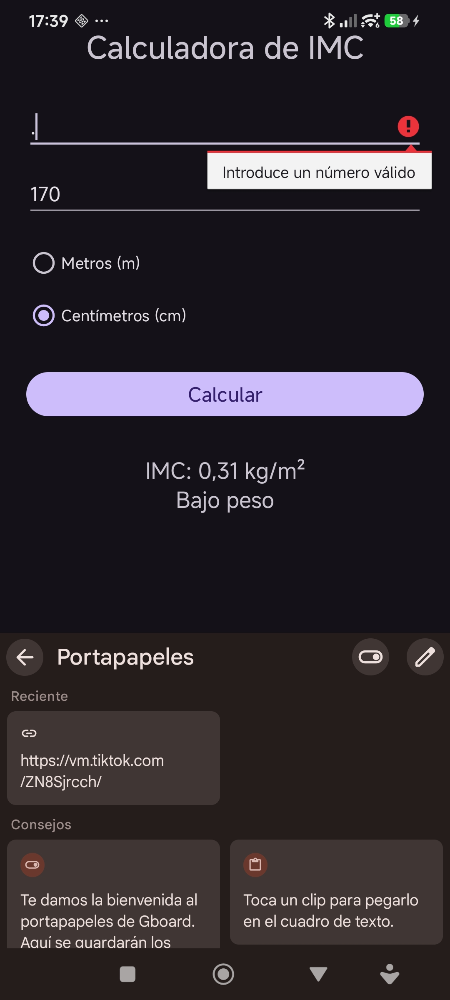
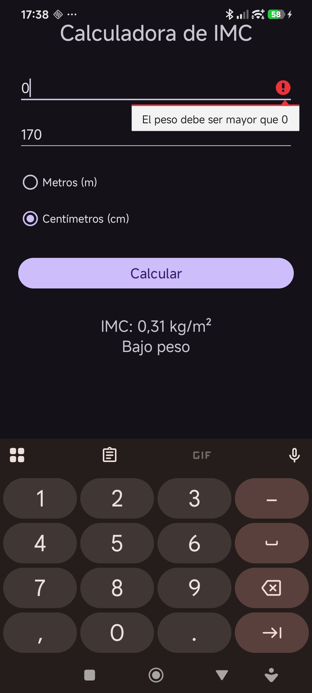
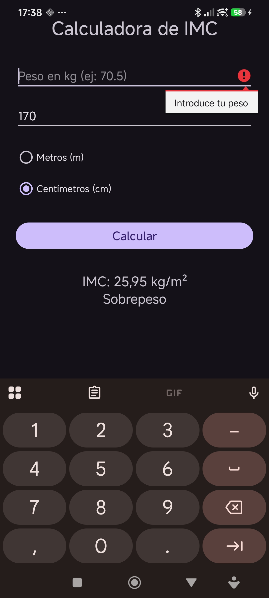

# Calculadora de IMC

Aplicación Android hecho en Java que calcula el Índice de Masa Corporal a partir del peso (kg) y la altura.

## Temática elegida
Opción C: Calculadora de IMC. He usado RadioGroup para elegir si la altura se introduce en metros o en centímetros.

## Validación
Al pulsar "Calcular" se comprueba que:
- Ningún campo esté vacío (se avisa con `setError()`).
- Los valores sean números válidos (se captura `NumberFormatException`).
- El peso y la altura sean mayores que 0.

## Cálculo
El IMC se calcula en el método `calcularImc(peso, altura)` y se muestra con 2 decimales junto a su categoría.

## Pruebas de Validaciones

Introducir un número válido

Número surrealista

Campo vacío

